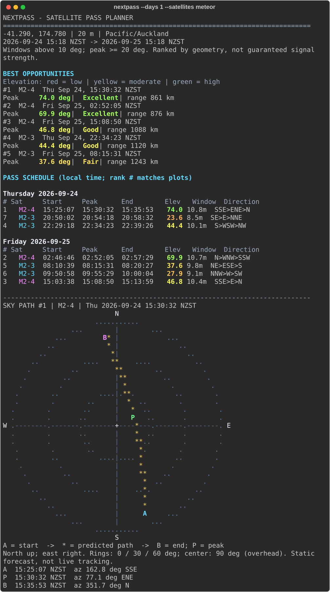

<div align="center">

<h1>🔭 nextpass 🛰</h1>

### Know when to point the antenna up.

Quick, terminal-based planning for satellite reception.
Pick from a curated catalog, a NORAD ID, or your own custom catalog.

<p>


</p>
<p>
<a href="https://github.com/gdamdam/nextpass/actions/workflows/tests.yml"></a>
<a href="LICENSE"></a>


</p>

</div>

---

## 🧭 Contents

[Quick start](#-quick-start) · [Example](#-example-output) · [Satellites](#-choose-satellites) · [Common tasks](#-common-tasks) · [Reading results](#-read-the-results) · [Pass report](#-shareable-pass-report) · [Sky-path pictures](#-daily-sky-path-pictures) · [Learn more](#-learn-more)

---

## ⚡ Quick start

### 1. Get the project

```sh
git clone https://github.com/gdamdam/nextpass.git
cd nextpass
python3 -m venv .venv
. .venv/bin/activate
python -m pip install -e .
```

<details>
<summary>Windows PowerShell</summary>

```powershell
py -3 -m venv .venv
.venv\Scripts\python.exe -m pip install -e .
.venv\Scripts\Activate.ps1
```

Both platforms expose the same `nextpass` command.
</details>

### 2. Set your private location

Run once with your coordinates and IANA timezone:

```sh
nextpass --save-location --lat LAT --lon LON --altitude METRES --timezone AREA/CITY
```

This creates a private file outside the repository with owner-only permissions.

<details>
<summary>Or create <code>~/.config/radio/location.json</code> by hand</summary>

```json
{"lat": 0.0, "lon": 0.0, "altitude": 0, "timezone": "UTC"}
```

| Key | Value |
|---|---|
| `lat`, `lon` | Degrees |
| `altitude` | Metres |
| `timezone` | IANA name, e.g. `Europe/Rome` |
| `horizon` *(optional)* | List of `{"az", "el"}` points, e.g. `[{"az": 0, "el": 5}, {"az": 135, "el": 22}]`, usually written by `--survey-horizon` to model local obstacles |

Restrict access to the file:

```sh
chmod 600 ~/.config/radio/location.json
```
</details>

### 3. Predict passes

```sh
nextpass --days 7
```

The first run downloads orbital data and prints your schedule.
No personal location is built in.

---

## 🖥 Example output

A one-day Meteor forecast for Wellington, New Zealand, trimmed after the first sky plot:

```sh
nextpass --lat -41.29 --lon 174.78 --altitude 20 --timezone Pacific/Auckland --days 1 --satellites meteor --plots 1
```

<p align="center">

</p>

---

## 🛰 Choose satellites

Built in, from [`catalog.json`](catalog.json):

| Group | Satellites |
|---|---|
| Weather (LEO) | Meteor-M2-3, M2-4 · Metop-B, C · Fengyun-3A, 3C |
| Weather (GEO) | GOES-18, 19 (fixed-dish HRIT/EMWIN) · Elektro-L 3 |
| Space stations | ISS · Tiangong (CSS) |
| Amateur | AO-73 · RS-44 · SO-50 · AO-123 · AO-91 · FO-29 |

```sh
nextpass --list-satellites                     # labels, groups, NORAD IDs, verification dates
nextpass --satellites meteor --days 3
nextpass --satellites iss,m2-4,so-50 --days 3
```

Omit `--satellites` to include all built-ins. You can also use a NORAD ID
directly or a [custom catalog](docs/guide.md#extend-the-satellite-catalog).

---

## 🎛 Common tasks

Add these options to `nextpass --days 7`. Run `nextpass --help` for all options.

**Filter and rank**

| Task | Options |
|---|---|
| Find higher passes during convenient hours | `--min-elevation 40 --hours 08:00-22:00` |
| Prefer longer reception windows | `--rank-by duration` |
| Prefer daylight ground tracks for weather imagery | `--rank-by imagery` |
| Show possible visual passes | `--satellites stations --visible-only` |
| Include low passes normally hidden by the 20° minimum | `--all-passes` |
| Model obstacles around your antenna | `--survey-horizon` once; every later run uses the mask |

**Live tracking and radio**

| Task | Options |
|---|---|
| Watch live pointing angles | `--live --satellites meteor` |
| Stream rotor-ready azimuth/elevation records | `--live --live-format jsonl --satellites M2-4` |
| Plan Doppler correction at 137.9 MHz | `--frequency 137.9 --track-csv track.csv` |
| Show a ground position and horizon footprint | `--ground-track` |
| Include radio frequency information | `--radio` |
| See recent volunteer reception reports | `--recent-reports` |

**Export and reminders**

| Task | Options |
|---|---|
| Export a calendar with a 30-minute reminder | `--ics passes.ics --reminder-minutes 30` |
| Run local desktop reminders | `--watch --reminder-minutes 30` |
| Export results for other tools | `--json passes.json --csv passes.csv` |
| Save a shareable report for your phone | `--report passes.html` |
| Use previously cached data without downloads | `--offline` |
| Show the schedule without sky plots | `--no-plot` |

### What these options do

| Option | Details |
|---|---|
| `--frequency 137.9` | Prints estimated downlink tuning at AOS, peak, and LOS |
| `--track-csv` | Adds a sampled frequency and azimuth/elevation schedule |
| `--live` | Updates pointing angles until Ctrl-C |
| `--live-format jsonl` | Streams the angles for other software |
| `--rank-by imagery` | Samples daylight beneath the satellite; downloads a planetary ephemeris on first use |

> [!NOTE]
> nextpass does not command a rotor or retune an SDR.

### Reminders

- **Calendar:** import the ICS file to get alarms from your calendar app.
  Regenerating it at the same path keeps event IDs when a predicted peak shifts
  by 20 minutes or less.
- **Desktop:** `--watch` checks for passes and refreshes predictions every six hours.
  - **macOS:** `nextpass --service install` starts a background service;
    `nextpass --service uninstall` removes it.
  - **Linux:** run `--watch` under a user service manager.

> [!WARNING]
> Service logs can contain your location.

### Radio reports

- `--radio` shows published SatNOGS transmitter records.
- `--recent-reports` shows past AMSAT volunteer reception reports.
- Neither confirms that a transmitter will be active during your pass.

The schedule flags overlapping passes on different satellites so a single SDR
operator can choose which one to receive.

---

## 📖 Read the results

| Topic | What to know |
|---|---|
| **Ranking** | Passes sort by peak elevation. `--rank-by duration` favors longer windows; `--rank-by imagery` favors daylight beneath the satellite. |
| **Default thresholds** | A reception window starts and ends at 10° elevation. Only passes peaking at 20° or higher appear. |
| **Visual passes** | The filter samples sunlight and darkness across each pass. It cannot account for clouds or brightness. The first online use downloads a planetary ephemeris. |
| **Orbital data** | Cached for six hours. Use `--refresh` when you need current elements; avoid repeated refreshes within CelesTrak's two-hour update cycle. |

> [!IMPORTANT]
> All rankings are geometry-based: none predicts signal strength or whether a
> transmitter is active. Antennas, obstructions and interference also affect
> reception. Local obstructions are modeled only when a horizon mask has been
> surveyed (`--survey-horizon`).

> [!CAUTION]
> **Privacy:** exports contain coordinates, and pass times can reveal your
> location. Keep them and your location file outside Git; ignore rules alone do
> not prevent accidental sharing.

---

## 📱 Shareable pass report

Save one HTML file with the schedule and sky charts, ready to send to a phone:

```sh
nextpass --days 3 --report passes.html --no-plot
```

**Contents**

- A card for each of the `--top` passes: start, peak and end times, azimuths,
  window length, and a sky chart.
- A table listing every pass by day.
- Extras when enabled: Doppler offsets (`--frequency`), visual notes
  (`--visibility`), radio data (`--radio`), and the shaded horizon mask.

**Behavior**

- No extra packages; works offline.
- Follows the phone's light or dark mode.
- Use the browser's Share, Print or Save as PDF to keep a PDF copy.

---

## 🗓 Daily sky-path pictures

Install image support into the active environment (ordinary predictions do not need it):

```sh
python -m pip install 'matplotlib>=3.7'
```

Save every above-horizon pass for one satellite on a local calendar day:

```sh
nextpass --satellites M2-4 --date 2026-09-23 --day-plot meteor-day.png --no-plot
nextpass --satellites M2-4 --day-plot meteor-today.pdf --no-plot
```

- Omit `--date` to plot today in your configured timezone.
- Save as PNG, PDF or SVG; PDF is handy for printing.
- Each pass gets a sky panel with direction arrows, rise/set times, peak time
  and elevation, and orbital epoch.
- North is up, east is right, the outer ring is the horizon, and the centre is overhead.

**`--day-plot` rules** (one satellite, one full local day):

- Overrides `--days` and includes low passes by setting both elevation thresholds to 0°.
- Rejects `--hours` and `--visible-only`, which would hide some passes.
- A pass belongs to the day of its peak, even if its track crosses midnight.
- `--no-plot` hides terminal plots but still saves the image.

To include low passes in the normal terminal schedule without a picture:

```sh
nextpass --days 2 --satellites meteor --all-passes
```

`--all-passes` sets both elevation thresholds to 0°; date, satellite and explicit
hour/visibility filters still apply.

---

## 📚 Learn more

- [Sky plots and output fields](docs/guide.md#reading-the-output)
- [Calendar exports and visual passes](docs/guide.md#calendar-events-and-reminders)
- [Radio metadata](docs/guide.md#optional-radio-metadata) · [Orbital data and caching](docs/guide.md#orbital-data-freshness)
- [Location configuration](docs/guide.md#private-location)
- [Pip installation](docs/guide.md#quickstart) · [Tests and validation](docs/guide.md#validation)

Use [iqscan](https://github.com/gdamdam/iqscan) to inspect the recording afterward.

---

## 📄 License

[GPL-3.0-only](LICENSE)
